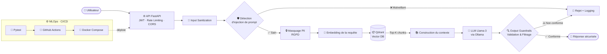

 

**Élève-Ingénieur TIC @ Sup'Com (Tunisie) — Spécialité IA, Data & MLOps**

---

## 👨‍💻 À propos de moi

🎓 Élève-ingénieur en **TIC à Sup'Com**, passionné par l'**IA Générative** (LLM, RAG, Agents), le **Machine Learning** et le **MLOps**.

🛡️ Je conçois des **pipelines LLM sécurisés** (Guardrails, détection d'injection, anonymisation PII conforme RGPD), des systèmes de **recherche sémantique** (Qdrant) et des moteurs prédictifs complexes.

🚀 Je combine **rigueur algorithmique**, **Data Science** et **culture logicielle** (FastAPI, Docker, n8n, CI/CD) pour mettre en production des solutions IA **performantes, fiables et scalables**.

> 💡 *"Ship AI that is not only smart, but safe, tested and reproducible."*

---

## 🧰 Stack Technique

### 🤖 AI / ML

`UMAP` · `t-SNE` · `Isolation Forest` · `K-Means` · `GMM` · `PCA` · `RAG` · `Agentic Workflows` · `Prompt Security`

### ⚙️ Backend & MLOps

### 🗄️ Databases, Web & Cloud-Ready

---

## 🚀 Projets Phares

<table>
  <tr>
    <td width="33%" valign="top">
      <h3>🛡️ Safe & Reliable AI via Guardrails</h3>
      
Pipeline de sécurité <b>end-to-end</b> pour agents LLM : sanitization des entrées, détection dynamique des injections de prompts, anonymisation PII conforme RGPD et CI/CD automatisée.

      

        
        
        
        
        
      

      
    </td>
    <td width="33%" valign="top">
      <h3>🔎 Production RAG Application</h3>
      
Architecture <b>RAG complète</b> pour l'indexation et la recherche vectorielle sémantique de documents, avec base vectorielle Qdrant et interface Streamlit.

      

        
        
        
        
      

      
    </td>
    <td width="33%" valign="top">
      <h3>⚽ ML Football Scouting & Analytics Engine</h3>
      
Moteur d'analyse prédictif : <b>clustering avancé</b> (PCA, K-Means, GMM), <b>détection d'anomalies</b> (Isolation Forest) et projections tactiques (UMAP / t-SNE).

      

        
        
        
        
      

      
    </td>
  </tr>
</table>

> 🔗 Tous mes dépôts : [github.com/fz-hazem?tab=repositories](https://github.com/fz-hazem?tab=repositories)

---

## 🏗️ Architecture type : Pipeline LLM Guardrails + RAG

---

## 📊 Statistiques GitHub

 

---

## 🎯 Focus actuel

- 🔬 Approfondir les **architectures RAG** avancées et les **workflows agentiques**
- 🛡️ Renforcer la **sécurité des LLM** (injection, fuite de données, conformité RGPD)
- ⚙️ Industrialiser des pipelines **MLOps** (CI/CD, conteneurisation, tests)
- 🤝 Ouvert aux **stages PFA / PFE** et collaborations en IA Générative & Data Science

---

## 📫 Connect with me

  

⭐ *Si un de mes projets vous plaît, n'hésitez pas à lui laisser une étoile !* ⭐

